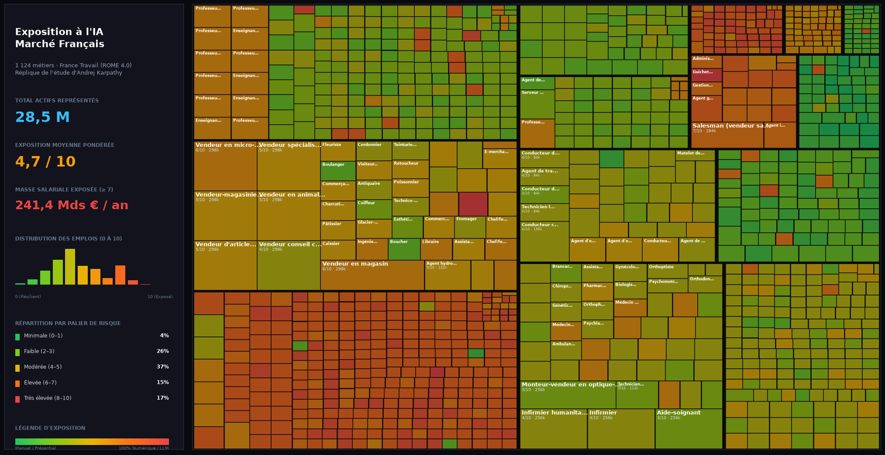

# Exposition à l'IA du Marché du Travail Français

Analyse de la susceptibilité de chaque profession de l'économie française face à l'intelligence artificielle et aux agents autonomes, réplique ouverte de l'étude d'**Andrej Karpathy** ([karpathy/jobs](https://github.com/karpathy/jobs)) adaptée au marché de l'emploi en France.

**Visualisation Treemap Haute Résolution :**



---

## 🎯 Ce que contient ce projet

Le référentiel officiel **ROME 4.0 de France Travail** et la base **Idéo-Fiches Métiers de l'Onisep** couvrent **1 124 métiers** représentant l'intégralité de l'économie française (**~28,5 millions d'actifs occupés**). 

Pour chaque profession, le projet extrait les missions détaillées, les compétences, les conditions de travail, le niveau d'études requis, le salaire brut annuel en euros et les perspectives d'embauche, puis évalue son **score d'exposition à l'IA (0 à 10)** avec un argumentaire analytique (rationale).

---

## 📊 Principaux Enseignements Macroéconomiques

| Indicateur Clé | Valeur France | Analyse |
| :--- | :---: | :--- |
| **Actifs couverts** | **28 499 399** | Couverture intégrale des 14 domaines professionnels ROME |
| **Exposition moyenne pondérée** | **4,69 / 10** | Légèrement inférieure aux USA (5,3/10) due au poids des métiers de soins et manuels |
| **Emplois fortement exposés ($\ge 7$)** | **6 041 844 (21,2 %)** | Fonctions support, informatique, finance, droit et communication |
| **Masse salariale exposée ($\ge 7$)** | **241,4 Milliards € / an** | Forte concentration sur les métiers de cadres et professions intellectuelles |

---

## 📐 Méthodologie d'Évaluation de l'Exposition à l'IA (Échelle 0 à 10)

L'exposition à l'IA mesure l'intensité avec laquelle les technologies d'IA (LLMs, vision par ordinateur, agents logiciels, automatisation cognitive) vont remodeler une profession, à la fois par :
1. **Effet direct :** Automatisation partielle ou totale de tâches aujourd'hui assurées par des humains.
2. **Effet indirect :** Gains de productivité massifs réduisant le volume total d'emplois nécessaires pour produire le même livrable.

Le facteur discriminant majeur est la **nature du produit du travail** : un métier dont la production est 100 % numérique et réalisable sur ordinateur présente par nature une exposition très élevée ($\ge 8$). À l'inverse, les métiers exigeant une présence physique dans un environnement non standardisé, de la motricité fine ou de l'empathie humaine directe bénéficient d'une barrière naturelle.

### Grille d'Ancrage et Exemples Calibrés :

| Score | Niveau de Risque | Exemples Concrets en France | Facteurs Clés |
| :---: | :---: | :--- | :--- |
| **0–1** | **Minimale** | Couvreur, bûcheron, élagueur, maçon, plongeur, ouvrier paysagiste | Travail physique en extérieur imprévisible, gestes manuels non automatisables sans robotique humanoïde avancée. |
| **2–3** | **Faible** | Électricien, plombier, pompier, boulanger, mécanicien automobile, aide-soignant | Dextérité manuelle, diagnostic physique in situ, contact humain direct ; l'IA n'intervient qu'en périphérie administrative. |
| **4–5** | **Modérée** | Infirmier, policier, vétérinaire, kinésithérapeute, pilote de ligne, cuisinier | Métier hybride : soins physiques ou pilotage de terrain combinés à une forte composante documentaire et diagnostique. |
| **6–7** | **Élevée** | Enseignant, architecte, journaliste, médecin généraliste, manager commercial | Métier de la connaissance où la synthèse est accélérée par l'IA, mais où la pédagogie, l'empathie et la décision restent humaines. |
| **8–9** | **Très élevée** | Développeur informatique, data analyst, traducteur, graphiste, comptable, juriste | Activité 100 % sur écran : production de code, de texte, de calculs ou d'images déjà profondément transformée par l'IA générative. |
| **10** | **Maximale** | Opérateur de saisie, conseiller relation client à distance, transcripteur | Traitement d'informations textuelles routinières ou téléprospection standardisée, déjà entièrement automatisable par les agents IA. |

---

## 🗂️ Fichiers Clés du Dépôt

| Fichier / Répertoire | Description |
| :--- | :--- |
| [`site/`](./site) | Application web complète (Treemap squarifié interactif en Vanilla JS / Canvas) |
| [`site/data.json`](./site/data.json) | Données consolidées pour l'interface (1 124 métiers avec scores et métriques) |
| [`occupations.json`](./occupations.json) | Référentiel complet des métiers (titre, ROME, effectif, salaire, diplôme, missions) |
| [`occupations.csv`](./occupations.csv) | Export tabulaire CSV des données socio-économiques |
| [`scores.json`](./scores.json) | Scores d'exposition (0-10) et rationales argumentés en français |
| [`pages/`](./pages) | 1 124 fiches métiers individuelles rédigées en Markdown |
| [`raw_data/`](./raw_data) | Données brutes ouvertes téléchargées (Onisep XML/JSON, ROME XLSX) |
| [`jobs_france.png`](./jobs_france.png) | Capture haute résolution du treemap et du volet analytique |

---

## ⚡ Reproduction Rapide (100% Gratuit)

Le projet s'exécute avec l'outil ultra-rapide [`uv`](https://github.com/astral-sh/uv) (ou avec un environnement Python virtuel standard). **Aucun abonnement ni clé API payante n'est nécessaire.**

```bash
# 1. Cloner le dépôt
git clone https://github.com/eliottrouvier/jobs-france-karpathy.git
cd jobs-france-karpathy

# 2. Installer les dépendances Python
uv sync

# 3. Télécharger les données ouvertes officielles (France Travail & Onisep)
uv run python scrape.py

# 4. Traiter et générer les fiches métiers Markdown & CSV
uv run python process.py

# 5. Calculer les scores d'exposition à l'IA et les rationales
uv run python score.py

# 6. Assembler le jeu de données pour l'interface web
uv run python build_site_data.py

# 7. Lancer le site treemap interactif en local
cd site && python3 -m http.server 8000
```

Ouvrez ensuite votre navigateur sur [http://localhost:8000](http://localhost:8000) pour explorer le treemap interactif.

---

## 🌐 Déploiement sur GitHub Pages

Le répertoire `site/` est totalement autonome (HTML/CSS/JS natif, sans compilation Webpack ou Node.js requise). Pour le publier en ligne gratuitement :
1. Rendez-vous sur votre dépôt GitHub : **Settings > Pages**.
2. Dans **Source**, sélectionnez **Deploy from a branch**.
3. Choisissez la branche `main` et le dossier `/site`.
4. Votre site interactif sera en ligne en quelques secondes !

---

## 📚 Sources des Données Publiques

- **France Travail :** [Répertoire Opérationnel des Métiers et des Emplois (ROME 4.0)](https://candidat.francetravail.fr/metierscope/) et enquête [Besoins en Main-d'Œuvre (BMO 2026)](https://www.francetravail.org/statistiques-et-analyses).
- **Onisep :** [Idéo-Fiches Métiers & Idéo-Métiers](https://opendata.onisep.fr) sous licence ouverte (Etalab).
- **DARES & France Stratégie :** Rapports prospectifs *« Les Métiers en 2030 »* et portraits statistiques des familles professionnelles (FAP).
- **INSEE :** Enquêtes Structure des Salaires et Emploi.
